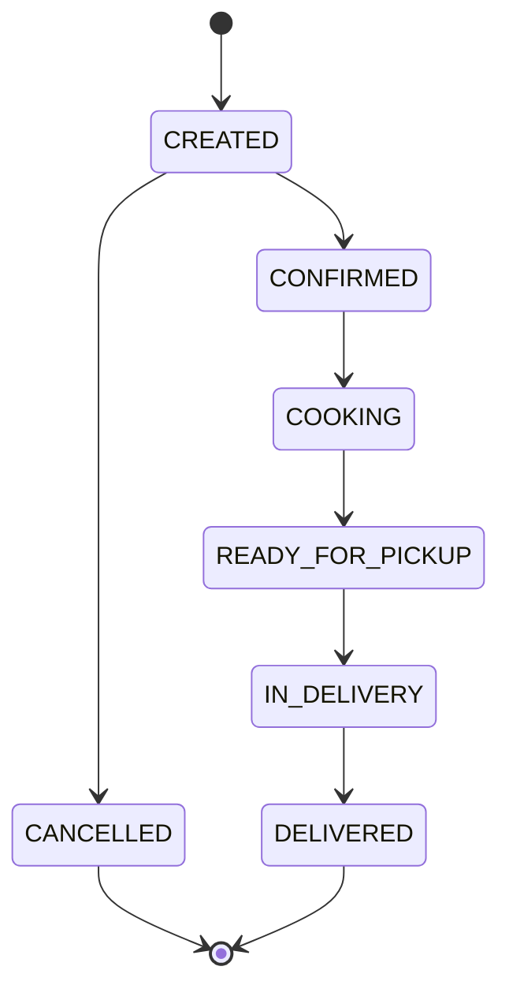

# Food Delivery API

A Go backend for browsing menus, placing orders, and updating order status.
It uses PostgreSQL, chi, and pgx. Restaurants receive new orders through webhooks
signed with HMAC-SHA256.

The project includes a small restaurant simulator that accepts orders and moves
them through the cooking steps.

## Run it

You need Docker with Compose. From the project folder, run:

```sh
docker compose up --build
```

Make sure ports 8080, 8081, and 5432 are free before starting.

| Service | Address |
|---|---|
| Main API | `http://localhost:8080` |
| Restaurant simulator | `http://localhost:8081` |
| PostgreSQL | `localhost:5432` |

On the first run with an empty database, Docker creates the tables and adds one
restaurant with pizza and drinks. The demo menu uses Russian names.

Open [Swagger UI](http://localhost:8080/swagger/) to read the API docs and send
requests. The [OpenAPI file](docs/openapi.yaml) is also in the repository.

To stop the services and keep the database:

```sh
docker compose down
```

## Try an order

The examples below use Bash syntax. On Windows, you can send the same requests
through Swagger UI.

List restaurants and check the demo menu:

```sh
curl http://localhost:8080/api/v1/restaurants

curl http://localhost:8080/api/v1/restaurants/11111111-1111-1111-1111-111111111111/menu
```

Place an order using an item from the demo menu:

```sh
curl -X POST http://localhost:8080/api/v1/orders \
  -H "Content-Type: application/json" \
  -H "X-User-ID: 00000000-0000-0000-0000-000000000001" \
  -d '{
    "restaurant_id": "11111111-1111-1111-1111-111111111111",
    "delivery_address": "10 Main Street",
    "contact_phone": "+79991234567",
    "items": [
      {
        "item_id": "44444444-4444-4444-4444-444444444444",
        "quantity": 1,
        "expected_price": 590.00
      }
    ]
  }'
```

Use the returned order ID to check its status:

```sh
curl http://localhost:8080/api/v1/orders/ORDER_ID \
  -H "X-User-ID: 00000000-0000-0000-0000-000000000001"
```

The simulator checks the webhook signature, accepts the order, and updates it to
`COOKING`, then `READY_FOR_PICKUP`. Watch the steps in the Compose logs:

```sh
docker compose logs -f core restaurant-mock
```

## How it works

- The API checks that the restaurant is open, the items are available, and the
  prices match the request.
- The order and its items are saved in one database transaction. Item names and
  prices are saved with the order, so later menu changes do not change old orders.
- After saving the order, the API sends a signed webhook to the restaurant.
  The restaurant uses the partner API and its `X-API-Key` to accept or reject it
  and update the cooking status.
- A background worker cancels orders that have not been confirmed within ten
  minutes. It checks for expired orders every ten seconds.



The simulator stops at `READY_FOR_PICKUP`. Delivery steps use a separate internal
API. All routes and request bodies are listed in Swagger UI.

The code is split into HTTP handlers, business logic, and database access under
`internal/core`. The restaurant simulator is under `internal/restaurant`.

More detailed flow diagrams are available in Russian:
[customer flow](docs/diagrams/cjm_client.md) and
[restaurant flow](docs/diagrams/cjm_restaurant.md).

## Tests

Use Go 1.27 or later. Run these commands from the project folder:

```sh
go test ./...
go vet ./...
go build ./...
```

The tests cover order rules, price and availability checks, HTTP handlers,
webhook signatures, and timeout handling. They use mocks and local test servers;
a running PostgreSQL instance is not required.

For lint checks, use golangci-lint 2.14.0:

```sh
golangci-lint run
```

GitHub Actions runs tests with the race detector, static analysis, lint checks,
and Docker builds for both services.

## Limits

This is a local demo with a few shortcuts:

- Clients pass `X-User-ID` directly. There is no user login or identity check.
  Restaurants use API keys; internal delivery routes have no authentication.
- The database starts with one restaurant. The schema supports more.
- SQL setup runs only when the database is empty. Existing databases need a
  separate migration step.
- Prices use `float64` in Go. Exact money calculations would need integer minor
  units or a decimal type.
- Webhooks have no stored queue or automatic retries. A failed send is logged;
  an order left unconfirmed is later cancelled by the timeout worker.

The credentials in Compose are for local development.
